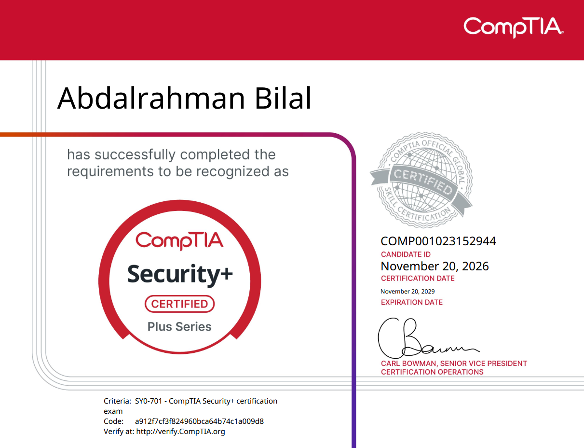
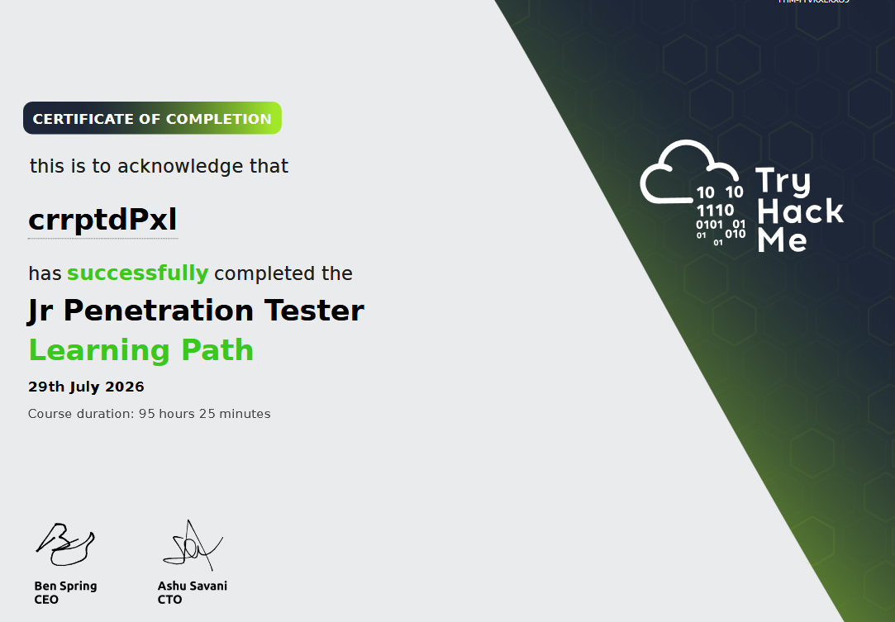
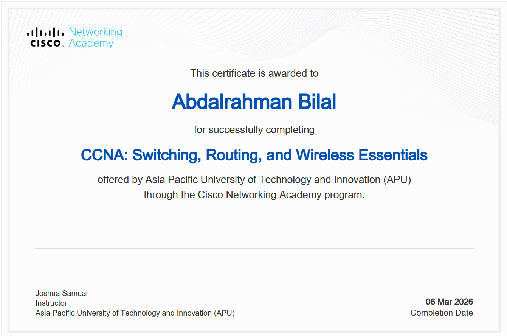
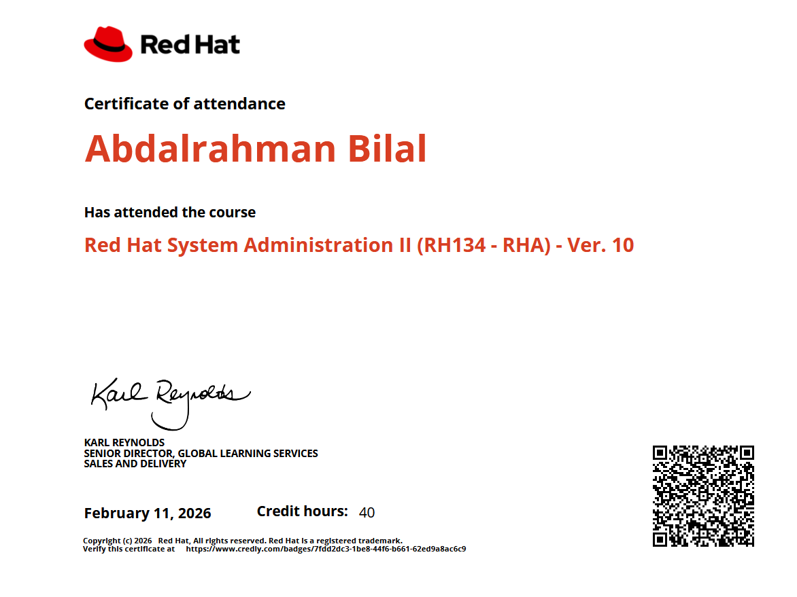
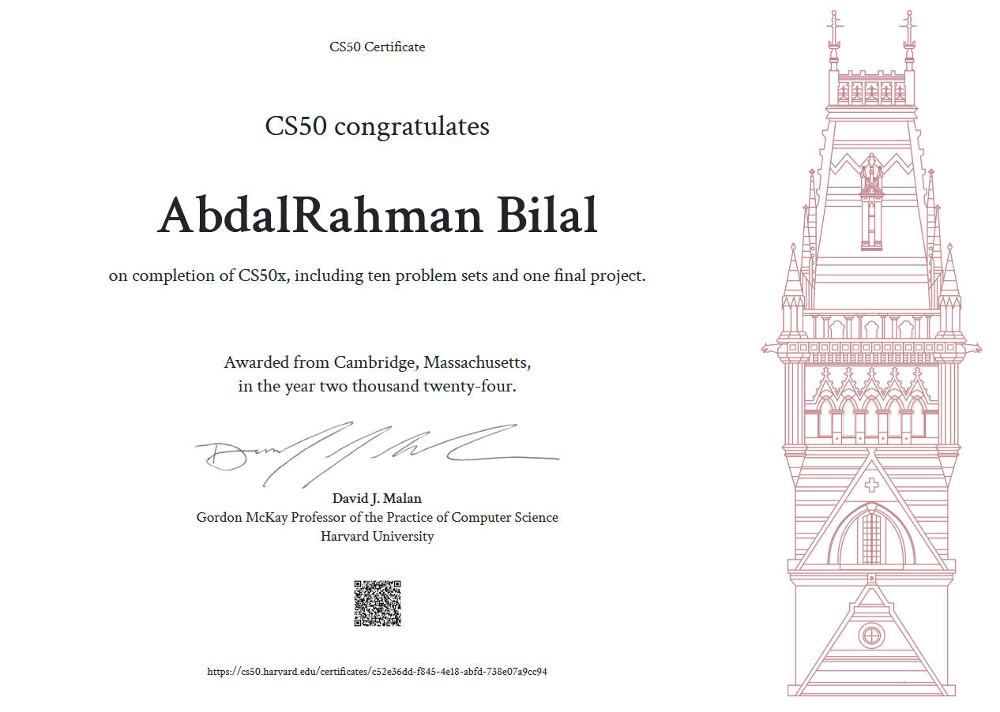

<h1 align="center">Abdalrahman Bilal Mustafa</h1>
<h3 align="center">Cyber Security & Network Engineer</h3>

  Final-year B.Sc. Computer Science (Cyber Security) student at Asia Pacific University 
  Based in Jeddah, Saudi Arabia · Open to roles preffered in Europe and the Arabian Gulf

  <a href="[www.linkedin.com/in/abdalrahman-bilal-b42b54391]">LinkedIn</a> ·
  <a href="mailto:[abdulrahmanbilalmustafa@gmail.com]">Email</a> ·
  <a href="[assets/Resume.pdf]">Download CV</a>

---

## About Me

I'm a cyber security and network engineering graduate-to-be who enjoys building and securing the infrastructure organizations rely on. I've worked in a university Network Operations Center and as a Cyber Security Analyst Intern at the Islamic Development Bank, where I led a multi-factor authentication migration and worked on identity and access management and a bunch of other projects. In addition to I am a CTF player in diverse platform such as; TryHackMe placing at top **2%**,HackTheBox, PicoCTF and etc. I'm now looking for a Security and Network Engineer role where I can combine both areas.

- 🎓 Vice Chancellor's List, CGPA 3.66 / 4.0
- 🔐 Focus: identity & access management, network security, security operations
- 🌍 Seeking for opportunities
- 📚 Currently studying for CCNP Enterprise (ENCOR 350-401)

---

## Experience

### Cyber Security Analyst Intern · Islamic Development Bank (IsDB)

`[August 2026 – November 2026]`

- Organized the migration of **400 users** to multi-factor authentication (MFA), using the technology and authenticator technologies.
- Managed identity and access management (IAM) using **Keycloak**, automating the access management using a trigger and domain inclusion.
- Authored a proposal for building a **Security Operations Center (SOC) team**, within a specific budget and on-premises software
- **Switching & Routing** configuration and hardening for production use 

### Network Operations Center (NOC) · Asia Pacific University

`[March 2026 – June 2026]`

- **Cable tracing and identification:** Traced and identified physical network cabling using a tone emitter and signal receiver, so faults could be located and cables labeled accurately.
* **CCTV quality control:** Checked CCTV cameras for coverage, image quality and working condition across campus.
* **WiFi quality control:** Tested campus wireless coverage and performance to find weak spots and keep service consistent.
* **CCTV placement management:** Planned and tracked camera positions so surveillance coverage matched the layout of each area.
* **Floor plan management:** Maintained and updated floor plans that mark network points, cabling routes and device and camera locations, keeping the documentation accurate.

---

## Featured Projects

### Secure Remote Access to a Home Network

Remote access to my home network from another country, using a repurposed old phone running Linux as a gateway.

- **What it does:** lets me reach home devices securely from abroad over SSH and xrdp.
- **Tech:** Linux, SSH, xrdp, openVPN
- **Security considerations:** sshkey-based authentication and hardening steps
- **Link**🔗 [Remote Home Access](https://lnkd.in/p/g8ngbn-3)
  
  

### Octupus - Home network monitor and DNS Filtering

Headless laptop turned into a home server by removing the broken screen, installing SIEM (wazuh) and PiHole for home network monitoring and DNS filtering

- **What it does:** lets me monitor my home network devices and alert me when unusual incident occurs to compare and measure it to a standard matrix of security incident frameworks

- **Tech:** Wazuh, PiHole

- **Security consideration:** Hardening the server itself before the other devices

- **Link**🔗[Octupus](assets/_project_0ct0pu5.md)
  
  

### MFA - IAM and Migration techniques

* **What it does:** Demonstrates and compares Multi-Factor Authentication (MFA) and passwordless authentication flows—including TOTP, Passkeys, FIDO2, and Windows Hello for Business—using a self-hosted Keycloak lab.
* **Tech:** Keycloak, Java JDK, OpenSSL (Custom CA/HTTPS), Microsoft Authenticator, FIDO2 / WebAuthn.
* **Security consideration:** Configuring custom TLS/SSL certificates and trusting a local Certificate Authority (CA) to satisfy WebAuthn's strict HTTPS origin requirements, while keeping private keys and biometrics isolated locally on the user's device.
* **Link:** 🔗[IAM and Migration techniques](assets/IAM and Migration.md)

---

## Skills

| Area                    | Skills                                                                                                               |
| ----------------------- | -------------------------------------------------------------------------------------------------------------------- |
| **Network Engineering** | Cisco enterprise networking (CCNP ENCOR in progress), [routing & switching, VLANs, OSPF/BGP, wireless], GNS3, EVE-NG |
| **Security**            | Identity & Access Management, Multi-Factor Authentication, Keycloak, [SIEM, vulnerability assessment, hardening]     |
| **Operations**          | Network monitoring (NOC), incident response, SOC planning, [ticketing/monitoring tools]                              |
| **Systems & Scripting** | Linux, SSH, remote access, [Python, Bash, PowerShell]                                                                |

---

## Certifications

- CompTIA Security+ SY0-701 
- Junior Penteration Tester (JrPT)
- CCNA: Switchl, Routing, and Wireless Essentials 
- Red Hat System Administration II (RH134 - RHA) 
- Red Hat System Administration I (RH124 - RHA) 
- CS50x: Introduction to Computer Science 
- Cisco CCNP Enterprise, ENCOR 350-401: *in progress*

---

## Education

**Bachelor of Computer Science (Cyber Security)**
Asia Pacific University of Technology & Innovation (APU), Malaysia
Expected graduation: `[Sep 2027]` · CGPA 3.66 / 4.0 · Vice Chancellor's List

---

## Let's Connect

I'm actively looking for a **Security and Network Engineer** position. If you're hiring, I'd love to talk.

📧 abdulrahmanbilalmustafa@gmail.com · 💼 www.linkedin.com/in/abdalrahman-bilal-b42b54391
